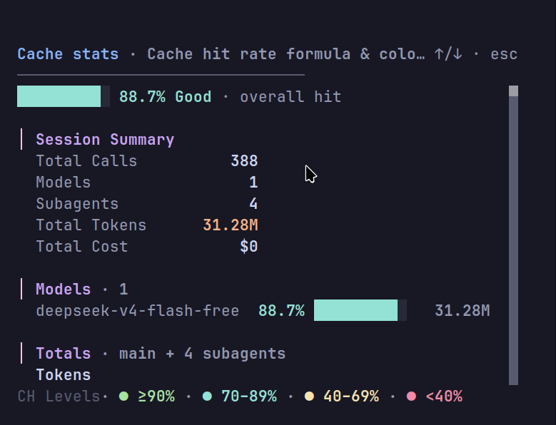
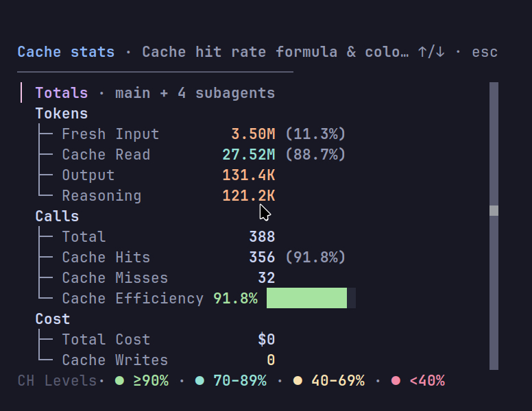
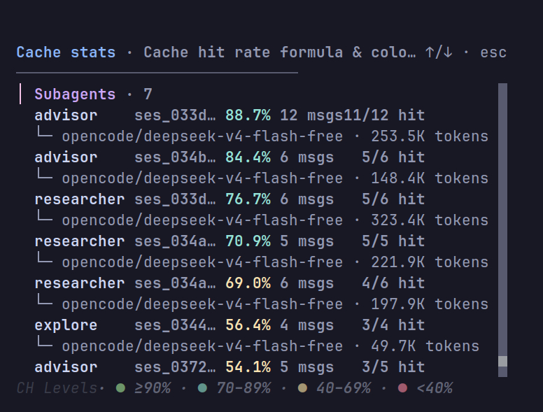

# /cache-stats

/cache-stats is a lightweight TUI plugin for opencode that displays the active session's cache statistics in a popup dialog. It provides the overall cache hit rate, a breakdown by model and subagent, and the associated costs, making it easy to understand cache performance at a glance.

> Run the `/cache-stats` command (or the `cache-stats.show` command) inside a session to open the dialog.

| Summary and models | Totals breakdown | Subagents |
|:---:|:---:|:---:|
|  |  |  |

## What it shows

The dialog shows:

- The overall cache hit percentage of the active session. A hit bar and a verdict word (Excellent, Good, Fair, or Poor) show the level.
- A session summary: total calls, model count, subagent count, total tokens, and total cost.
- A per-model breakdown with hit bars, hit percentages, and token totals.
- Grouped totals for tokens, calls, and cost. The totals include percentages and averages per call.
- A subagent list with the hit rate of each subagent and the model that each subagent used.

The plugin computes the cache hit rate with this formula:

```
hit = cache read / (input + cache read)
```

A cache write is a one-time priming cost. It is excluded from the hit ratio. The plugin also reports the number of API calls that read from the cache.

## Install

Install the plugin from this repository with the opencode CLI:

```
opencode plugin -g "opencode-cache-stats@git+https://github.com/nmdra/opencode-cache-stats.git"
```

The `-g` flag installs for every project. Omit it to install for the current project only. `opencode plug` is an alias for `opencode plugin`.

Update with `-f` (\"Replace existing plugin version\"), pin a release with `#vX.Y.Z`, and remove the plugin by deleting its entry from `tui.json`.

After you install, restart [opencode](https://opencode.ai). Then run the `/cache-stats` command inside a session.

## Documentation

- [index](docs/index.md) — overview
- [installation](docs/installation.md) — how to install the plugin
- [usage](docs/usage.md) — how to use the plugin
- [how-it-works](docs/how-it-works.md) — how the plugin collects the data
- [colors](docs/colors.md) — how the plugin colors the rate
- [troubleshooting](docs/troubleshooting.md) — how to fix common errors
