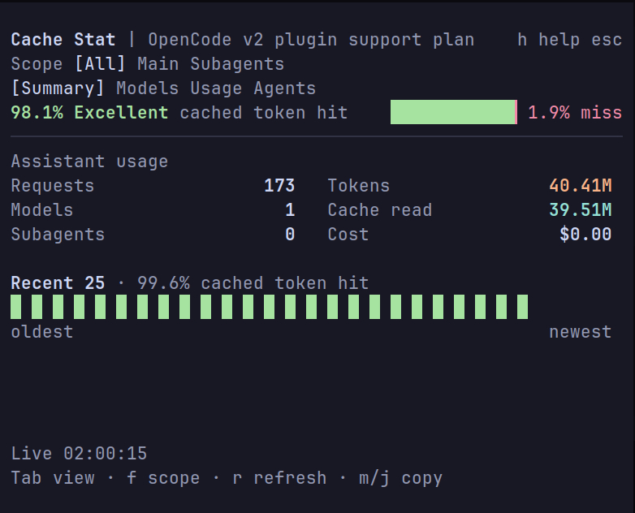
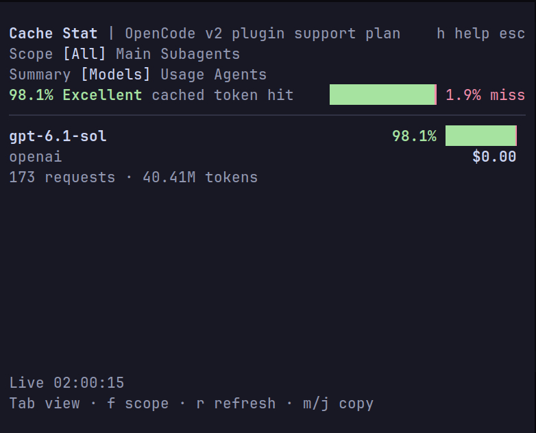
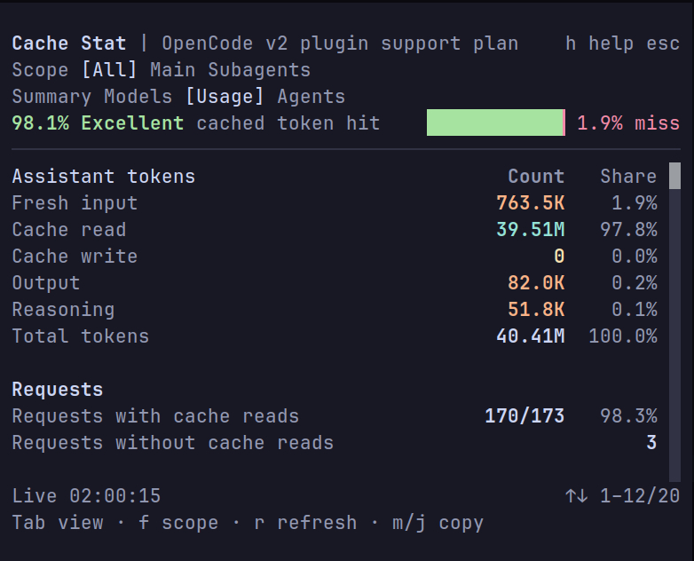

# /cache-stats

/cache-stats is a lightweight CLI/TUI plugin for **OpenCode V2**. It shows cache statistics for the active session in a dialog. The dialog includes statistics by model and subagent, token totals, and recorded costs.

This branch targets OpenCode **2.1.4**. For OpenCode V1, use the [`v1` branch](https://github.com/nmdra/opencode-cache-stats/tree/v1).

> To open the dialog, run `/cache-stats` or `cache-stats.show` inside a session.

The screenshots below show the V2 Summary, Models, and Usage views.

| Summary | Models | Usage |
|:---:|:---:|:---:|
|  |  |  |

## What it shows

The dialog shows:

- The overall cache hit rate for the active session. A bar and a word (Excellent, Good, Fair, or Poor) show the level.
- A session summary: total requests, model count, subagent count, total tokens, and total cost.
- Statistics for each model, with cache hit bars, cache hit rates, and token totals.
- Grouped totals for tokens, requests, and cost. The totals include percentages and averages per request.
- A subagent list with the cache hit rate of each subagent and the model that each subagent used.
- Live refresh with **All / Main / Subagents** filters and a trend for the latest 25 recorded requests.
- Compaction tokens and cost in a separate section. Compaction does not change the request totals for assistant steps.
- A cache indicator in the sidebar and Markdown/JSON reports that you can copy to the clipboard.

The plugin calculates the cache hit rate with this formula:

```
hit = cache read / (input + cache read)
```

A cache write is a one-time priming cost. The plugin excludes cache writes from the cache hit rate. The plugin also reports the number of API requests that read from the cache.

Requests are assistant steps with recorded usage, not individual retry attempts. **All** includes the active session and all descendants, including history before compaction. The plugin reports compaction separately. It excludes title generation and other auxiliary calls. The open dialog refreshes at step boundaries. If a refresh fails, the dialog keeps the data from the last successful refresh and marks that data as stale.

The dialog opens on **Summary**. It shows compact totals and a recent-request trend with spaces between the glyphs. Use **Tab** / **Shift+Tab** to switch between Summary, Models, Usage, and Agents. The scope filter, overall cached token hit rate, and status stay visible when you scroll. The dialog does not show empty compaction sections or repeat accounting notes. Help contains these details.

Press **f** to change the scope. Press **r** to refresh. Press **m** to copy Markdown or **j** to copy JSON. Press **h** to open help. Use Up/Down and Page Up/Page Down to scroll. Use Home/End to move to the first or last row. Press Escape to close the dialog.

Reports include the whole selected scope, not only the visible tab. Exports require terminal OSC 52 clipboard support. Exports include session metadata, but no prompts, tool outputs, or compaction summaries.

## Install

1. Copy the V2 plugin directory (not a single TSX file):

```sh
mkdir -p ~/.config/opencode/plugins/cache-stats
cp plugins/cache-stats/{package.json,tui.tsx,view.tsx,presentation.ts,controller.ts,collect.ts,stats.ts,live.ts,report.ts,sidebar.tsx} \
  ~/.config/opencode/plugins/cache-stats/
```

2. Add the plugin to `plugins` in the global `~/.config/opencode/cli.json`. Keep the other settings:

```json
{
  "$schema": "https://opencode.ai/v2/cli.json",
  "plugins": ["./plugins/cache-stats"]
}
```

If `XDG_CONFIG_HOME` is set, use `$XDG_CONFIG_HOME/opencode` instead. OpenCode also finds this global plugin directory automatically. The explicit entry shows that the plugin is enabled. This local installation does not need a server plugin or npm installation.

See [`cli.json.example`](cli.json.example). Configuration changes reload automatically. If necessary, use `/reload`. Open a session. Then run `/cache-stats`.

The sidebar indicator is enabled by default. It uses totals for assistant steps in the selected session and its descendants. To disable the indicator, use an options entry in `cli.json`:

```json
{
  "plugins": [{ "package": "./plugins/cache-stats", "options": { "sidebar": false } }]
}
```

## Development

Use Node.js 26.4 or newer. The OpenTUI development dependencies require this version or a newer version.

```sh
npm ci
npm test
npm run typecheck
```

The plugin uses the client connected to the terminal, including connections to remote servers. It does not read the local OpenCode database or start a separate service.

## Documentation

- [index](docs/index.md) — overview
- [installation](docs/installation.md) — how to install the plugin
- [usage](docs/usage.md) — how to use the plugin
- [how-it-works](docs/how-it-works.md) — how the plugin collects data
- [colors](docs/colors.md) — how the plugin uses colors for the cache hit rate
- [troubleshooting](docs/troubleshooting.md) — how to fix common errors
- [V2 API references](docs/how-it-works.md#references) — official documentation and the client contract for the target version
